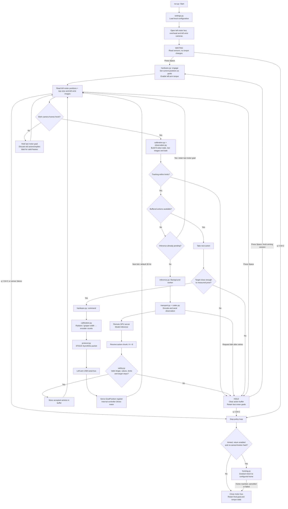

# Standalone ELRobot inference controller

This folder contains its own Python inference/control pipeline and copies of
the configuration needed to control the ELRobot's left follower arm. It runs without RCS,
openpi-client, a Rust extension, or a running norma-core station service.
You can move this entire folder elsewhere; its code and configuration do not
load files from the original workspace.

The supported policy interface uses an openpi-compatible WebSocket server,
an overhead RGB image and a left wrist RGB image, an 8-value left-arm joint state,
and chunks of absolute joint/gripper targets. The model itself still runs on
the remote GPU server. Model weights are not included in this folder.
The server must be configured/trained for this single-arm, two-image
contract; a previous 16-value, three-camera policy is not automatically compatible.

## Quick start: no hardware

Use Python 3.11 or newer. Install the dependencies into this folder's own
environment. Run the commands below from the workspace containing
`custom_control`. If this folder is already your current directory, skip the
`cd custom_control` line. With `uv` installed:

```bash
cd custom_control
uv --cache-dir .uv-cache venv --python python3 .venv
uv --cache-dir .uv-cache pip install --python .venv/bin/python -r requirements.txt
.venv/bin/python run.py --check-config
.venv/bin/python run.py --steps 90
```

The default is **dry-run + mock policy**: simulated motor readings, synthetic
camera images, and a policy that holds its first observed pose. It opens no
robot devices or network connections. Each run writes configuration snapshots
and a JSONL telemetry log under `logs/` in this folder.

If using pip instead, run these commands from inside `custom_control`:

```bash
python3 -m venv .venv
.venv/bin/python -m pip install -r requirements.txt
.venv/bin/python run.py --check-config
.venv/bin/python run.py --mode dry-run --policy mock --steps 90
```

Systems missing the venv bootstrap module can use the `uv` commands above.

Run the tests with:

```bash
.venv/bin/python -m unittest discover -s tests -v
```

## Commands at a glance

Run these from inside `custom_control`, after installing the dependencies:

| Purpose | Command |
|---|---|
| List available options | `.venv/bin/python run.py --help` |
| Validate the local configuration without opening devices | `.venv/bin/python run.py --check-config` |
| Test only the policy connection, without robot/camera access | `.venv/bin/python run.py --check-connection --token-env JUPYTER_TOKEN` |
| Try the complete pipeline with mock sensors and policy | `.venv/bin/python run.py --mode dry-run --policy mock --steps 90` |
| Read the actual left arm, overhead camera and left wrist camera without motor writes | `.venv/bin/python run.py --mode observe --steps 90` |
| Arm the real left arm with a holding mock policy | `.venv/bin/python run.py --mode hardware --policy mock --steps 0` |
| Move the real left arm gradually to its saved home pose | `.venv/bin/python run.py --mode hardware --home --steps 0` |
| Run the actual policy | Use the WebSocket command in step 6 below |

`--steps` counts total loop ticks, including time spent waiting or holding.
At 30 Hz, 90 ticks take about 3 seconds. `--steps 0` keeps the session open
until you quit. Hardware mode starts disarmed: press Space to arm, Space again
to hold, and `q` or Ctrl-C to end the policy and return an armed robot home
before exiting. These hardware commands operate the left
arm only and require the overhead and left wrist cameras.

## Connect the physical rig

1. Check `config/runtime.json`, `config/rig-map.json` and
   `config/calibration.json`. These copies belong to this particular rig.
   The calibration export is dated 2026-08-17; startup checks adapter serials
   and EEPROM offsets so a stale or different rig's calibration is refused.
2. Ensure the `/dev/elrobot/...` device names exist. A copy of the rig's udev
   rules is in `config/99-elrobot-rig.rules`. If they are not already installed,
   an administrator can install this local copy:

   ```bash
   sudo cp config/99-elrobot-rig.rules /etc/udev/rules.d/99-elrobot-rig.rules
   sudo udevadm control --reload-rules
   sudo udevadm trigger
   ```

   The left serial adapter needs `dialout` access; both V4L2 cameras
   need `video` access. The archived udev rules/device map also describe the
   other devices on the original rig; they are not opened by this controller.
   The wrist cameras have identical serial numbers, so the left wrist's udev
   rule identifies its USB socket. Check that `/dev/elrobot/left_wrist_cam`
   still refers to the left wrist camera after recabling.
3. Stop other applications that own these serial ports/cameras, including the
   station service or an existing teleoperation process.
4. Read sensors without sending motor commands:

   ```bash
   .venv/bin/python run.py --mode observe --steps 90
   ```

   This checks the left arm's 8 motors, the overhead camera and the left wrist camera. Joint measurements
   are recorded in the run's `events.jsonl`. Observe mode never enables torque,
   changes motor profiles, or calls the policy server. It leaves any existing
   motor torque state as it was.
5. Test hardware arming with the holding mock policy:

   ```bash
   .venv/bin/python run.py --mode hardware --policy mock --steps 0
   ```

   Hardware starts in `WAITING`, without changing torque. **Space** writes the
   current pose as each left-arm servo's goal, sets and verifies the RAM motion profile,
   enables torque, and arms the loop. Space again enters `HOLD`. `q` or Ctrl-C
   ends the policy. By default, an armed robot then returns to its saved home
   before the controller exits, retaining torque at home. The shutdown behavior
   and its cancellation controls are described below.
6. Run the remote policy when the rig is ready:

   ```bash
   .venv/bin/python run.py --mode hardware --policy websocket --steps 0 \
     --server-url ws://131.220.7.73:8000 \
     --instruction "pick up the red brick and place it in the blue bowl"
   ```

   The address above is copied from the saved launch setup, not probed or
   verified. Change it in `config/runtime.json`, with `--server-url`, or use
   `--server-url-env` as described below.
   Hardware mode requires an interactive terminal; there is no automatic
   unattended arming flag.

## Return home when the program finishes

`return_home_on_exit` is enabled by default in `config/runtime.json`:

```json
"return_home_on_exit": true
```

After an armed policy session, pressing **q**, pressing **Ctrl-C**, or reaching
`--steps` stops inference/action streaming, runs the gradual home move, and only
then closes the serial bus. No extra Space press is needed to start this return.
The destination is the existing `home_joints_rad` in `config/robot.json`.
The gripper keeps its width and torque remains enabled after arriving home.
The policy's step-count limit does not shorten this return; the home timeout
and measured tracking checks still apply.

During the return, press **q**, **Space**, or **Ctrl-C** again to cancel it and
retain the last motor goal. A homing fault/timeout ends the return instead of
retrying indefinitely. This uses joint interpolation without collision planning;
ensure the path is clear before running an armed session.

Automatic homing is skipped if the session was never armed, was read-only, or
ended with a sensor/hardware exception or a latched tracking/serial fault.
This avoids commanding another move after the robot has stopped following.
Temporary missing/stale camera frames now cause a recoverable wait rather
than a sensor exception. That wait alone does not block return-home; an
existing tracking fault still does.
Invalid policy chunks or server errors latch HOLD; after you end such an armed
session, homing can still proceed if there was no sensor or motion fault.
The standalone `--home` command is not repeated on exit, so cancelling that
command does not trigger another home move.

To leave an armed session at its last commanded pose instead, set the JSON
field to `false` or append `--no-home-on-exit` to your usual run command.

The original RCS policy runner also performs its park step in `finally`, before
closing hardware. It parks to the measured resting pose with collision planning
and then gradually releases torque. This controller returns to the configured
home with its local homing module and holds there; it does not implement RCS's
park planner or torque-release procedure. Startup remains disarmed and does not
automatically home the real arm.

## Move the left arm home manually

Stop the inference session with `q` so it releases its serial port, then run:

```bash
.venv/bin/python run.py --mode hardware --home --steps 0
```

The command prints the destination and waits. Press **Space** to enable torque
at the current pose and start moving gradually. Space again pauses; Space from
HOLD resumes from a fresh measured pose. **q** or Ctrl-C cancels and retains
the last servo goal/torque state. When home is confirmed by motor feedback for
three ticks, the command exits with the arm still holding home.

The destination is `home_joints_rad` in `config/robot.json`, currently:

```json
[0.0, -0.6, 0.2, 0.2, 0.0, 0.0, 0.0]
```

These are seven joint angles in radians, not a Cartesian position. The gripper
keeps its width from arming. Homing needs no policy server, token, or cameras.
It interpolates a line in joint space without collision planning: make sure
the entire motion has clearance before starting.

In `config/runtime.json`, `home_speed_rad_s` defaults to 0.2 rad/s,
`home_tolerance_rad` to 0.02 rad, `home_max_tracking_error_rad` to 0.15 rad,
and `home_timeout_s` to 30 seconds per attempt. Homing uses the smaller of the
configured policy joint-step limit and 0.05 rad per tick, and the smaller of
the policy tracking limit and the homing tracking limit. Increasing the policy
step limit therefore does not make the home command jump to its destination.
Tracking faults or a timeout latch HOLD; a failed sensor read ends the session.

To test the home-command flow with simulated hardware:

```bash
.venv/bin/python run.py --mode dry-run --home
```

The mock robot starts at home already, so this normally completes immediately.

## Token-protected JupyterLab proxy

For a policy server on port 8000 behind your JupyterLab tunnel, set the full
WebSocket proxy URL and the Jupyter token in the same terminal that launches
the controller. Keep the `/proxy/8000/` path and trailing slash:

```bash
export POLICY_SERVER_URL='wss://port8888-rgrjj05e563nnw4.tunnel.applications.eu-north1.nebius.cloud/proxy/8000/'
read -r -s -p 'Jupyter token: ' JUPYTER_TOKEN
echo
export JUPYTER_TOKEN
```

The token prompt hides your input and avoids putting the token itself into a
shell command. Alternatively, provide `JUPYTER_TOKEN` through your terminal's
normal environment setup. A local env-file fallback is also supported below.

Validate the variables and local configuration without opening a connection
or accessing hardware:

```bash
.venv/bin/python run.py --check-config --policy websocket \
  --server-url-env POLICY_SERVER_URL --token-env JUPYTER_TOKEN
```

Test the actual WebSocket handshake and server metadata **without opening any
robot or camera devices**:

```bash
.venv/bin/python run.py --check-connection \
  --server-url-env POLICY_SERVER_URL --token-env JUPYTER_TOKEN
```

This sends no inference observation and no motor commands. It reports a
connection attempt, successful metadata reception, or a failure such as HTTP
403. The token and query parameters are omitted from connection-status logs.
`--check-config` only checks local settings; `--check-connection` contacts the
selected server. Hardware runs still connect lazily after Space arms the loop.

Run the actual left-arm policy with overhead and left wrist images:

```bash
.venv/bin/python run.py --mode hardware --policy websocket --steps 0 \
  --server-url-env POLICY_SERVER_URL \
  --token-env JUPYTER_TOKEN \
  --instruction "pick up the red brick and place it in the blue bowl"
```

Press Space to arm. The two arguments take **environment variable names**,
not their contents: use `--token-env JUPYTER_TOKEN`, rather than expanding
`$JUPYTER_TOKEN` on the command line.

You can also give the URL directly while keeping the token in its variable:

```bash
.venv/bin/python run.py --mode hardware --policy websocket --steps 0 \
  --server-url "$POLICY_SERVER_URL" --token-env JUPYTER_TOKEN
```

URL selection order is explicit `--server-url`, then the variable selected by
`--server-url-env` (or `server_url_env` in the JSON), then saved `server_url`.
If a selected variable is missing or empty, startup fails instead of silently
using a different server. `--token-env` overrides the JSON's `token_env` name.
With no token variable selected, the client uses the URL without authentication.

For persistent defaults, set these names in `config/runtime.json`:

```json
{
  "server_url_env": "POLICY_SERVER_URL",
  "token_env": "JUPYTER_TOKEN"
}
```

These are two fields to edit in the existing configuration, not a replacement
for the entire file. Export both variables before launching. Their initial
defaults are `null`, so existing direct connections continue to work.

`transport.py` constructs `wss://.../proxy/8000/?token=<URL-encoded-token>`
only for the connection. If the base URL already has a query, it appends
`&token=...`. The token is read again on reconnect. Configuration snapshots
contain the token variable's name and the token-free server URL; they never
contain the resolved token. Inline `?token=...` URLs and URL user credentials
are rejected. Connection errors omit authenticated URLs and arbitrary proxy
response text. An HTTP 401/403 error indicates you should check the token
and tunnel access; the client keeps TLS verification enabled.

### Using credentials from a local env file

The supplied `inference_example.py` loads credentials from `.env`/`station.env`
as well as the process environment. Its URL-token encoding matches this
controller. To use the same credential source, put the relevant connection
entries into a local file inside `custom_control`:

```bash
cp config/station.env.example config/station.env
```

Edit `config/station.env` and fill in the valid Jupyter token and URL. Actual
`*.env` files are ignored by Git. Then test without hardware:

```bash
.venv/bin/python run.py --check-connection \
  --env-file config/station.env --server-url-env POLICY_SERVER_URL
```

Selecting an env file defaults the token-variable name to `JUPYTER_TOKEN`,
as in the working example. `--token-env` can select a different name. Values
already exported in the terminal take precedence over the file, also matching
the example. An old exported `JUPYTER_TOKEN` therefore overrides a newly edited
file; use `unset JUPYTER_TOKEN` if you intend to use the file's token instead.

After a successful check, run:

```bash
.venv/bin/python run.py --mode hardware --policy websocket --steps 0 \
  --env-file config/station.env --server-url-env POLICY_SERVER_URL \
  --instruction "pick up the red brick and place it in the blue bowl"
```

The optional JSON field `env_file` can save this relative filename. The file
must remain inside this folder. It supports simple `KEY=value`, quoted values,
comments and an optional `export` prefix. It is never executed as shell code.
Its contents are not copied into run logs or inserted into `runtime.json`.

The example connects eagerly before creating its SO-101 robot. This controller
normally connects on first inference after arming; the connection-only check
isolates authentication from robot control. The example also uses six SO-101
state values, different image keys, and 224×224 image resizing. Those model-input
differences occur after the handshake and cannot explain HTTP 403. The current
ELRobot state/actions remain 8 values with overhead and left wrist images.

## Flow from inference to the motor



Each action has **8 values: 7 left-arm joint angles and 1 gripper width**.
The top-view image is the overhead stereo camera's left half, 800×600 RGB.
The left wrist camera contributes its full 640×360 RGB frame.
The chart shows hardware mode; dry-run uses mock devices and arms automatically,
while observe mode only reads sensors. Tracking and action execution occur only
while RUNNING. While WAITING or HOLD, the loop continues reading sensors and
checking keyboard commands without requesting new actions.

The main loop keeps reading sensors and processing space/q while inference is
pending. The servos hold their last written goal during the wait. A single
background thread owns the policy connection. Replies from a request made
before a hold/re-arm are discarded. There is no prefetch; a new chunk is
requested after the current chunk is consumed.

### Missing or stale camera frames

A camera gap skips the observation and waits for both cameras to have valid,
fresh RGB frames. The session stays open: keyboard commands and measured joint
tracking continue, but no new policy actions are written while waiting. Queued
actions and replies based on observations from before the gap are discarded.
After recovery, a still-RUNNING session requests a fresh action chunk. An
existing operator/tracking HOLD remains HOLD until explicitly re-armed.

An isolated failed capture read gets another read. Three consecutive failed
reads, a capture exception, or an unavailable device cause that camera's own
thread to release and reopen its handle. Reconnect attempts repeat every
`camera_retry_interval_s` seconds (default 1.0). If the device reports
`No such device`, the stream can recover once the OS/device becomes available
again; software cannot manufacture a frame while USB is disconnected.

Only fresh real frames are sent; old pixels are not substituted. Missing frames
do not expire the session, and q remains available while waiting. Arming is
refused until both cameras are ready. Tick records include `camera_waiting`,
with `camera_wait_started` / `camera_wait_finished` events for each gap. Motor
read errors and tracking failures retain their existing stop behavior.

## Files by purpose

| File | Responsibility |
|---|---|
| `run.py` | CLI options, construction and cleanup |
| `controller/settings.py` | Load and validate local configuration |
| `controller/calibration.py` | Left-arm encoder ranges ↔ radians/normalized gripper |
| `controller/protocol.py` | Packet framing, checksum, register reads and SyncWrite |
| `controller/hardware.py` | Adapter identity, motor reads, torque engagement, goal writes |
| `controller/homing.py` | Gradual homing with feedback checks and operator controls |
| `controller/shutdown.py` | Return an armed robot home before closing its motor bus |
| `controller/cameras.py` | Overhead and left wrist capture, BGR→RGB, freshness and device reconnection |
| `controller/observation.py` | Assemble the exact dictionary sent to the model |
| `controller/codec.py` | NumPy/msgpack representation compatible with openpi |
| `controller/transport.py` | URL/token environment selection, authenticated WebSocket handshake, inference requests, timeout/reconnect |
| `controller/inference.py` | Keep network waits out of the control loop |
| `controller/safety.py` | Whole-chunk checks, step limits and measured tracking |
| `controller/pipeline.py` | WAITING/RUNNING/HOLD and action streaming |
| `controller/keyboard.py` | Nonblocking terminal controls |
| `controller/recording.py` | Configuration snapshots and telemetry log |
| `tests/` | Tests with fake devices and a real loopback WebSocket server |
| `reference/protocol/` | Copied original packet/register reference and license |
| `reference/server_policy_example.py` | Archived original bimanual server adapter; not compatible with the active single-arm layout |
| `reference/COPIED_FILES.json` | Copy provenance and SHA-256 hashes |

The reference files are documentation, not imports or runtime dependencies.
Source paths in the provenance manifest and historical strings inside copied
configs are labels only; the controller never resolves them.

## Where configuration is saved

| Local file | Purpose |
|---|---|
| `config/runtime.json` | The active controller settings: server, ports, cameras, schema, timing, limits and servo RAM profile |
| `config/robot.json` | Copied joint limits, suggested home pose and rig geometry constants |
| `config/calibration.json` | Exact copy of the rig's export; only `left_follower` ranges and offsets are loaded |
| `config/rig-map.json` | Exact copy of adapter/camera identities and wiring notes |
| `config/99-elrobot-rig.rules` | Copy of stable device-name/access rules |
| `config/reference/station.yaml` | Original station configuration, archived for understanding; not read by this controller |
| `config/reference/station-calib.yaml` | Original station calibration configuration, also archived |
| `config/reference/intrinsics.json` | Original camera intrinsics, archived; not applied to the policy images |
| `config/reference/refinement*.json` | Original geometric refinements, archived; not applied by this joint-only pipeline |

Edit local copies to configure this controller. Its config paths must remain
inside this folder. Device paths naturally refer to OS hardware nodes. Installed
Python dependencies and the remote inference server are still required for
their respective run modes; no original repository checkout is required.

Each log directory contains the effective runtime configuration, copies of the
robot/calibration/device-map files, and `events.jsonl`. Records include measured
state, last commanded state, accepted chunks and stop reasons. These are
telemetry logs, not camera videos or LeRobot/Parquet training episodes.

## Exact policy contract

Default outgoing dictionary:

```text
observation.state                 float32 (8,)
observation.images.overhead       uint8 RGB (600, 800, 3)
observation.images.wrist          uint8 RGB (360, 640, 3)
task                              instruction string
```

State and action column order:

```text
0..6    left arm motor IDs 1..7, radians
7       left gripper, 0 closed / 1 open
```

The overhead camera delivers a 1600×600 stereo image; the controller takes its
left half as the 800×600 top-view image. The left wrist camera supplies a
640×360 image. The right arm and right wrist camera are not opened. No image resizing,
rectification, joint reordering, normalization or state padding happens here.
The server must use the same preprocessing as training. The server-side example
in `reference/` preserves the original bimanual setup for historical reference;
configure the server for the single-arm, two-image contract above before running hardware.

The server first sends one binary msgpack metadata dictionary, then responds to
each binary observation with a dictionary containing `actions`, a numeric array
of shape `(H, 8)`. All targets are absolute. A text reply is a fatal rejection.
Sixteen-column bimanual chunks are rejected rather than silently sliced.
Only transient transport failures are retried, using a new socket. If metadata
explicitly supplies `state_dim`/`action_dim`, both must be 8. Other metadata is
logged by key and is not enough to prove training compatibility.
The server must allow incoming messages larger than 2.14 MB, the combined raw
size of both RGB images plus state/task and serialization overhead.

## Motion checks and operational limits

- Entire chunks are checked for shape, horizon, finite values, limits and
  adjacent target jumps before any action is selected. The default executes
  only the first 30 actions, but invalid trailing actions still reject a chunk.
- Joint targets are limited to 0.05 rad per tick and gripper widths to 0.15 per
  tick. Small joint-limit overshoots up to 0.05 rad may be clipped and logged.
  Larger joint overshoots are rejected. Finite gripper targets outside [0,1]
  are clipped to that range and logged before the gripper step-size check.
- The first target must also be within these step limits of the held pose.
  There is no automatic transit to a far-away first target. If refused, prepare
  the starting pose using your existing rig procedure, then explicitly re-arm.
- Measured joint tracking error above 0.15 rad for three successive ticks
  latches HOLD. An individual new target too far from the measured pose is
  refused immediately. Tracking checks cover arm joints, not gripper force.
- Missing motor replies and checksum/status errors end the session while
  retaining the last servo goal and skipping automatic return-home. Missing or
  stale camera frames instead pause policy execution until fresh frames arrive.
  Camera age defaults to 0.5 seconds; reconnect retry defaults to 1.0 second.
  Serial reads have a 20 ms per-request timeout. All 8 left-arm motor
  readings are required; no missing reading is replaced with zero or cached.
- HOLD clears queued actions. A failed network request or invalid chunk cannot
  resume movement on its own. Space explicitly re-arms after a fresh reading.
- Arming only writes motor RAM; saved offsets, EEPROM limits and PID settings
  are never rewritten. Existing EEPROM torque limits still cap the RAM limit.
- This is a joint-position pipeline. It does not implement Cartesian actions,
  IK, collision/path planning, RCS's planned parking, gradual torque release,
  asynchronous prefetch, or the original geometric refinement wrapper. The
  saved home pose is used by the mock robot, the explicit `--home` command,
  and the default return-home stage on shutdown. Startup remains disarmed.
- The tick rate is best-effort Python timing. An overrun is reported; the loop
  never sends a burst of overdue commands. This software is not a physical
  emergency stop: motor/USB failure can prevent any corrective command.

## Verification

The tests cover calibration round trips, gripper direction, a captured servo
packet, fragmented/corrupt/missing replies, identity checks, engagement order,
invalid/trailing actions, tracking, stale cameras, hold behavior, read-only
mode, and openpi-compatible loopback inference. Hardware has not been energized
or physically tested as part of creating this folder.
